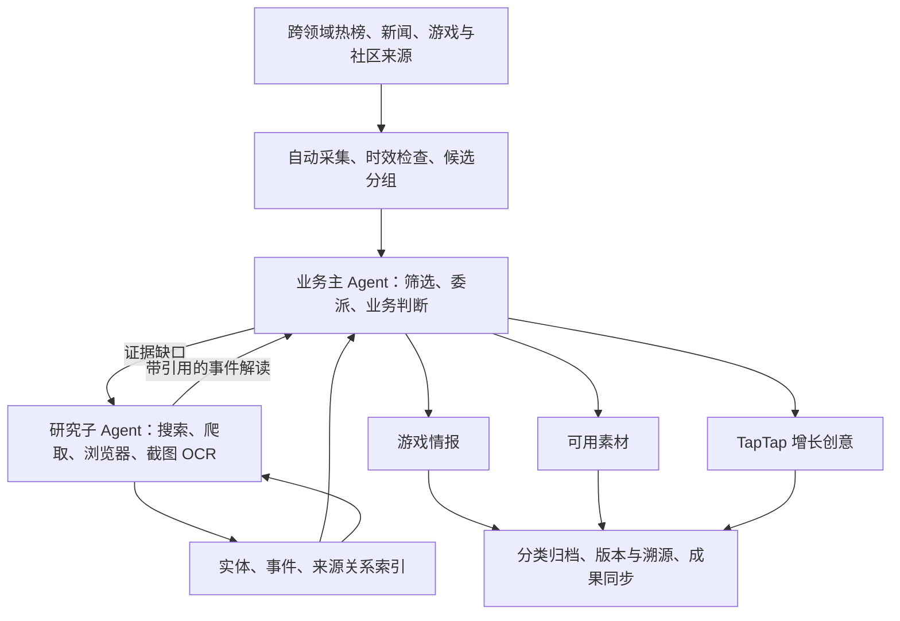

# TapTap 热点情报与素材系统

**持续从全网热点中，为 TapTap 积累游戏情报、可用素材，并识别增长创意的 AI 自动化系统。**

[](docs/版本记录.md)
[](https://github.com/hccccc01333/taptap-hotspot-intel/actions/workflows/ci.yml)
[](https://github.com/hccccc01333/taptap-hotspot-intel/actions/workflows/pages.yml)

[打开网站](https://hccccc01333.github.io/taptap-hotspot-intel/) · [架构详解](docs/V3-技术栈与历史编排.md) · [模型配置](docs/V3-模型供应商与自定义配置.md) · [实验方法](docs/V3-可复现对照实验.md) · [版本记录](docs/版本记录.md)

这是面向 TapTap 内容与运营场景的个人开源项目，非 TapTap 官方项目，不使用其内部业务数据。项目的目标是让使用者打开网站就能阅读分类成果；有疑问时，可以沿创意、情报、热点解读回到原始来源，而无需自己启动采集或生成任务。


<sub>工作台历史截图（2026-10-08），用于展示阅读形式；数量与内容不代表今天的成果或质量结论。</sub>

## 系统交付什么

| 入口 | 阅读内容 |
| --- | --- |
| 热点发现 | 谁发生了什么、一句话概括、近期传播依据；原帖标题不会自动成为热点结论 |
| 事件跟踪 | 背景、时间线、讨论焦点、质疑和后续进展，附来源与待确认事项 |
| 情报档案 | 游戏变化、玩家问题、社区创作、市场动向与中立风险观察，说明为何值得关注 |
| 素材库 | 可编辑文案、脚本、表达模板或游戏改编，附使用场景、来源和使用边界 |
| 增长创意 | 目标人群、创意切口、传播方法、TapTap 承接、用户动作及执行条件 |

热点发现覆盖社会、娱乐、文化、生活方式和游戏，再筛选与游戏社区的联系。情报、素材与创意分别判断：某个事件可以只有中立情报，也可以有可改编素材；不会为了填满页面，强行把它包装成推广机会。负面、争议及关键风险未确认的事件禁止生成推广素材和创意。

## 一个主 Agent，一个研究子 Agent

业务主 Agent 负责初筛、委派研究、业务判断和交付。研究子 Agent 负责补齐事件内容，根据证据缺口选择搜索、正文爬取、浏览器阅读、评论区滚动、截图与 OCR。情报、素材与创意是主 Agent 的三个业务分支，分别生成并校验，无需每个功能增加一个 Agent。



模型提出研究动作，程序通过统一 Tool Executor 检查参数和预算，执行工具并返回真实结果。模型最终 JSON 通过字段、引用、日期、风险与版本检查后才保存；另做确定性的断言-引用核对，证据不足的成果保留为草稿、不进入可直接使用的素材库。模型推理文本不作为业务结果。

后台自动产生、领取与恢复工作项，页面用于阅读。租约、过期恢复、写入幂等和来源版本守卫用于防止中断丢失、重复交付或旧结果覆盖。未确认事项进入补查队列；无法核实的内容保留缺口，不按正确事实发布。[自动执行与契约说明](docs/V3-自动执行可靠性与统一契约.md)。

## 技术与架构

| 技术 | 在本项目里的作用 |
| --- | --- |
| Python + SQLite | V3 持久任务编排，保存证据、解读、成果、图索引与运行记录 |
| FastAPI + Uvicorn | 查询接口与本地后台，启动服务时启动自动调度 |
| React + TypeScript + Vite | 五个成果入口、分类与搜索、详情、引用核查、复制和 Markdown 下载 |
| Requests + Beautiful Soup | 已接入公开渠道和新闻正文读取，记录实际阅读范围 |
| Playwright + Windows OCR | 动态网页、评论区滚动与截图转录；OCR 结果需对照核查 |
| JSON Schema | 主／子 Agent 的结构化交付契约与有限修正；不代替语义事实核验 |
| NetworkX + SQLite 图索引 | 实体、事件、来源主张与玩家需求的有依据关系检索和主题分组 |
| 可选本地 BGE | 相似内容召回；缺少依赖或权重时使用字符召回，并记录实际路径 |
| LangGraph | 保留的旧版分析图与巡检图；当前 V3 业务编排使用自己的持久队列 |
| GitHub Actions + Pages | 工程检查、静态网页部署，与独立成果数据分支配合更新网站 |

**GraphRAG**：借用实体关联、局部检索和社区摘要的思想，为两个 Agent 提供有出处的上下文。它是定制实现，没有安装完整 Microsoft GraphRAG，也未实现完整层级报告或 Global map-reduce。主题分组大小不等于热度，同游戏名不等于同事件。[图谱设计与边界](docs/V3-实体事件图谱与GraphRAG检索.md)。

**LangGraph / LangChain**：旧版 L4 用 `StateGraph`、节点、条件边与有限修订组织分析；历史巡检图另有 SQLite 检查点与中断恢复。未安装依赖时明确记录标准库回退。LangChain 的完整链式应用不是当前 V3 主链路，不能把依赖关系写成已使用全部框架能力。详细用法、模块位置和状态保存方式见[技术栈与历史编排](docs/V3-技术栈与历史编排.md#langgraph-在项目中怎么用)。

## 本地运行

需要 Python 3.11+、Node.js 与 npm；浏览器工具和 Windows 中文 OCR 需另行配置。当前 OCR 不是多模态大模型识图。[研究工具配置](docs/V3-研究工具与自动队列.md)。

```bash
git clone https://github.com/hccccc01333/taptap-hotspot-intel.git
cd taptap-hotspot-intel
python -m pip install -r requirements.txt
cd spatial
npm ci
cd ..
```

在本机配置模型供应商的密钥环境变量。支持 OpenAI、Claude、Gemini、Grok、DeepSeek、千问、GLM、Kimi、MiniMax、豆包、硅基流动、OpenRouter、Ollama 与自定义接口；实验还支持两个指定的 OpenCode Go 型号。模型 ID、推理参数、输出上限和实际账户权限需按各家接口核对，适配器存在不等于所有供应商均已真实在线验收。

账号配置留在本机，登录初始化与认证边界见 [Web 服务说明](webapp/README.md)。密钥不填入前端或提交到仓库。

```bash
python -m uvicorn webapp.main:app --host 127.0.0.1 --port 8202
```

另开终端，在 `spatial` 目录运行以下 PowerShell 命令：

```powershell
$env:VITE_DEV_API_TARGET = 'http://127.0.0.1:8202'
npm run dev -- --host 127.0.0.1 --port 5182 --strictPort
```

打开 `http://127.0.0.1:5182/`。本地维护者可通过“模型设置”配置并切换供应商，后台按保存的自动运行偏好工作。推理文本与最终输出分开处理，资源上限与质量验证分别设置。[供应商与参数说明](docs/V3-模型供应商与自定义配置.md)。

## 在线网站如何更新

前端相关源码推送到 `main` 后，Actions 构建并部署 GitHub Pages。本地后台每五分钟检查成果变化，同步整理后的字段到 `site-data`；网站定期读取这些成果。

GitHub Pages 只托管静态页面，不执行采集或模型任务。目前生产后台运行在本机；电脑关闭后，网站保留最后一次成果，并在同步过期时提示。推送 Python 源码仍需更新实际后台，不能让 Pages 自动执行它。[运行与部署](docs/V3-GitHub部署与成果同步.md)。

公开成果导出采用字段白名单，仅发布整理后的成果、短引用和来源链接。完整原文、评论、截图、运行库、账号配置和模型调用档案应留本地。仓库文件与历史提交的审查是另一个步骤，不能用导出校验代替它。

## 如何验证质量

用同一模型、相同初始线索对照三条路径：A 普通 LLM，B LLM＋搜索，C 真实完整 Agent 链路。样本、必要事实、推理与输出配置在运行前冻结；所有失败、拒绝、漏答与未运行项均保留。

核验事实、事件日期、引文是否支持结论、无依据断言、风险处理和必要事实覆盖；另查情报实际入库、素材是否可编辑使用、创意是否有具体 TapTap 承接。**token、费用与耗时另行记录，不进入质量评分。** 工程测试不能代替真实事实核查，输出数量不能代替可用性。

最新质量优先实验已执行 10 例、30 组：完整系统入库 5 条情报、2 条业务素材和 1 个创意，但连接失败与引用、参与路径错误仍存在。当前没有证明系统优于基线，也没有证明实际增长效果。来源核查由 Codex 完成，已知组别，未经开发者本人或独立人类复核；入库数量不代表质量通过。

- [实验协议与复现命令](docs/V3-可复现对照实验.md)
- [质量优先实验：全部 30 组、失败、部分交付与核查限制](docs/V3-质量优先ABC实验-20261012.md)
- [公开仓库审查与历史遗留](docs/V3-公开仓库审查-20261012.md)
- [全部 Alpha20 A/B 自评](docs/V3-Alpha20-全部AB质量核验.md)
- [Alpha23 新样本停止记录](docs/V3-Alpha23-新样本对照停止记录.md)
- [版本记录与各阶段验收](docs/版本记录.md)

项目处于 Alpha。来源覆盖有限，动态正文与评论可能读取失败，OCR 可能误识别，热点、引用语义和创意适配仍需真实样本打磨。增长创意是附带依据、假设与执行条件的草案。

## 代码与文档入口

- [`agent_v3/`](agent_v3/)：当前主／子 Agent、研究工具、图谱、契约、业务库与调度。
- [`spatial/`](spatial/)：当前 React 工作台，保留 V1／V2 入口。
- [`webapp/`](webapp/)：FastAPI 与本地认证。
- [`L1_data_source/`](L1_data_source/)、[`L4_intelligence/`](L4_intelligence/)、[`runtime/`](runtime/)：保留的采集与历史分析／巡检实现。
- [技术栈、数据如何变成成果、GraphRAG 与 LangGraph 详解](docs/V3-技术栈与历史编排.md)
- [主 Agent 与研究子 Agent](docs/V3-主Agent与研究子Agent.md)
- [热点解读与游戏交付契约](docs/V3-热点解读与游戏交付契约.md)

代码许可见 [LICENSE](LICENSE)。第三方报道、游戏画面、商标与素材不因本仓库代码许可而获得转载或商业使用授权。
