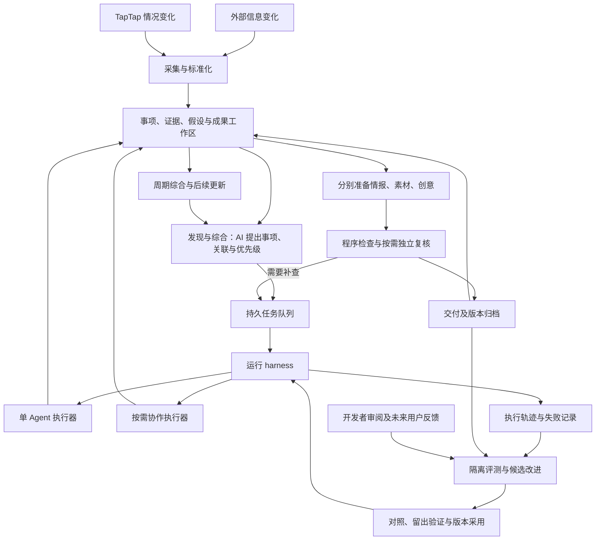

# V4 架构草案：外部信息＋内部情况＋输出交付

日期：2026-11-01（北京时间）
状态：设计草案，已被 [V4 架构冻结稿](V4_ARCHITECTURE.md)（2026-11-13）合并并取代；
本文件保留为时点材料与方向讨论记录。已认可总体方向；数据契约、执行策略、框架选择与
质量收益仍需验证。

## 1. 产品定位与设计依据

面向 TapTap 平台自己的社区运营，主动观察外部信息与内部情况，研究两者的联系，分别交付有依据的情报、可编辑素材和可测试的增长创意。

- 外部信息覆盖游戏及文化、娱乐、生活方式等相关领域，不限于热榜或站内社区。
- 内部情况包括 TapTap 的玩家兴趣、内容供给、产品入口和运营条件。首期使用可获取的站内公开数据；内部经营数据须有授权来源，未取得时保持未知。
- 社区运营是当前目标用户，不将观察范围与行动形式限制为社区帖子。
- 情报、素材、增长创意独立判断，不要求每条线索产出三类成果。
- 优先减少有价值机会的遗漏。站内已有充分讨论，可能意味着值得整理、放大、连接或组织，不能据此自动结束研究。
- 优秀案例是交付参照，反馈是改进材料。案例是否发布、是否被采用、是否执行及是否有效分别记录。
- 当前为个人开发项目，无法获得真实岗位任务。采用公开证据构造并明确标注的代理任务，开发者评审不冒充真实运营验证。

V4 不继承 V3 的 Agent 数量、职责划分或模块边界。历史能力仅在契约和测试满足新设计时复用。

## 2. 推荐结构及边界

采用“共享证据与持久任务为中心，按需组织 Agent”的轻量结构。持久状态由应用维护；Agent 通过工具提出研究分支、取得证据、形成业务判断和成果。

图中的节点是职责，不代表 Agent 数量、独立服务数量或固定执行顺序。情报、素材与创意不是必须串行通过的阶段。

首期允许单服务、持久数据库与证据文件存储，不以分布式消息集群、知识图谱或大量常驻 Agent 为前提。可借用现有持久运行时和深度 Agent 工具，但领域状态由本应用定义。

两个结构选择分开验证：

1. 长期工作如何组织：事项、变化、证据、任务和成果的持续关系。
2. 单项任务如何执行：单个 Agent，或协调者按需委派独立任务。

## 3. 运行 harness 的职责

### 3.1 主动发现与任务生命周期

- 外部与内部变化都能触发研究；支持事件变化、持续需求和周期综合等触发方式。
- 采集、格式标准化、基础去重和运行状态由程序处理；语义关联、价值假设及业务优先级由 AI 提议并附依据。
- 程序验证任务参数、依赖和状态变更，不把合法写入等同于业务判断正确。
- 对优先级不确定的候选保留探索机会；不只处理容易交付或已有高分的任务。
- 暂缓记录原因、缺口和重启条件。新证据能重新激活相关事项。
- 保存任务租约、尝试、中断恢复及幂等信息，避免重复执行或旧结果覆盖新结果。
- 任务队列的排队、运行、失败等执行状态，与事项是否值得关注、证据是否可信分开。

### 3.2 上下文、工具与协作

- 按任务检索外部证据、TapTap 情况、历史研究及案例，不默认塞入全部数据。
- 工具返回实际读取范围、时间、来源和失败原因。缺失字段不默认写成零。
- 结构化读取、正文、浏览器、截图 OCR 等是不同取证能力，根据缺口选择；工具使用次数不代表研究质量。
- 每个研究分支说明待回答问题，以及答案可能怎样改变后续判断。
- 委派包含问题、范围、已有证据、所需交付和停止条件；共享证据用稳定引用寻址。
- 子任务独立返回发现与缺口，汇总时可回到原证据，避免只有摘要而丢失语境。
- 上下文、调用、耗时和费用边界可配置并记录。资源用于约束运行，不混入业务质量评分。

### 3.3 交付与复核

- 分别定义情报、素材与创意的完成标准。
- 程序检查结构、引用可定位性、日期、版本和已知入口条件；语义支持性仍需针对性核验。
- 素材包含可编辑内容及使用边界，来源表达与原创改编分开。
- 创意说明目标人群、价值联系、传播或参与方式、TapTap 承接、执行条件与验证假设。
- 根据任务难度、证据冲突和潜在影响启用独立复核；复核结果不自动视为事实金标。
- 已完成任务可以没有创意，但需说明研究发现、未解决问题与处置依据。空交付不计作合格成果。

### 3.4 轨迹与配置

- 记录输入与来源版本、工具调用、实际结果、分支决策、校验、修订及最终交付。
- 不依赖保存模型私有思考文本来诊断系统。
- 提示词、工具说明、案例集合、策略、模型配置和执行器均有版本。
- 日常运行策略与评测规则分开维护，支持采用候选版本和回滚。

## 4. 需要持久保存的领域对象

以下是需要满足的语义边界，不预先规定必须一类对象一张表。

- **证据与快照**：稳定身份、来源 URL、发布时间、采集时间、实际读取范围、原始快照引用、内容版本。公开互动是采样观察，不等同于全体玩家或真实增长。
- **TapTap 上下文**：适用游戏或范围、产品状态、可用入口、资源条件、出处、核查时间与失效条件。公开观察和运营提供的信息注明来源类别。
- **事项**：触发线索、相关外部与内部证据、时间线、关联与合并记录。事项不要求先具有营销价值。
- **价值假设**：可能提供的情报价值、内容用途或行动方向，支持与反对证据、关键缺口、当前判断及修订记录。事实、推测和创作设想分开。
- **研究任务**：触发原因、问题、作用范围、上下文引用、执行器配置、依赖、运行状态、结果及重启条件。
- **成果与版本**：类型、正文、目标人群或使用场景、支持证据、条件、复核状态与被替代关系。三类成果独立存在。
- **案例与反馈**：当时目标、上下文、成稿、修改与原因。开发者自评、用户采用和真实执行效果分别标识。

证据失效或更正后，依赖它的假设和成果进入待复查，不直接推断它们全部错误。模型提出关联或给出高置信度，不能使未经核实的信息自动变成事实。

## 5. Agent 组织：保留可替换执行器

### 执行器 A：单个深度 Agent

同一 Agent 在一个事项内按需取证、综合和制作。具备工具、工作区、上下文管理与持久化入口。首轮基线不委派。

验证重点：方向遗漏、上下文丢失、引用支持与自评偏宽松。它可以成为正式执行方式，不预设为低质量对照。

### 执行器 B：协调者按需委派

协调者为适合独立探索的分支创建任务，获得结果后综合或补查。研究、业务综合、制作和复核是能力配置，不等于固定四名 Agent；不预设每项任务必须经过所有角色。

验证重点：额外覆盖是否抵消交接损失与重复研究，协调者是否过早缩小问题，以及资源与故障恢复。

首期只实现足以比较的执行接口和样例，不建设三套互相重复的完整产品。持久运行方式与执行器差异分别评测，避免无法解释收益来源。

## 6. 自动改进 harness

Harness² 提供可借鉴的任务内候选修改、执行对照和跨任务经验积累思路。它是可叠加的实验机制，不替代业务运行架构，也不证明业务增长。

首期先具备失败归类、可复跑任务和版本化配置。随后可尝试在隔离实验中调整：检索策略、案例选择、提示词、技能或工具说明。修改程序工具或协作结构时，另做对应工程验证。

候选优化使用训练／开发任务，留出任务不用于选择候选或修改评测规则。真实数据更新另设后续时间窗口，检查泛化与来源漂移。

采用修改需要有可复查的质量依据，同时检查机会遗漏、必要事实覆盖及其他能力回退；不能通过少处理困难任务或放宽引用标准提高分数。采用与回滚有版本记录。

## 7. 首期验证与验收

### 任务处理质量

使用公开证据构造代理任务，明确任务为模拟设定。任务覆盖外部变化、站内变化、已有充分讨论、长期兴趣、负面风险及无合理联系等情况，避免只挑能成功生成创意的样本。

冻结外部与内部输入快照、模型及配置、任务清单和评测规则。先在相同资源边界下比较执行器，再单列增加资源后的收益，所有失败、暂缓、未执行和未核实结果保留。

检查：预标注方向的遗漏、新发现方向的合理性、关键事实覆盖与支持、内部适配、素材可编辑性、创意承接及执行条件。标注不是穷尽答案，不能把超出预设的新合理方向判错。

程序核验客观条件；开发者核查语义与交付用途，标注自评身份。模型评价仅作为辅助，不报告为真实运营效果或独立人类评审。

### 系统持续运行

验证两个方向都能触发任务、相同变化不重复交付、中断后能恢复、旧结果不覆盖新版本，以及新证据能更新相关成果。另检查周期综合确实能连接多个事项，避免系统仅做局部加工。

检查点保存执行状态；证据快照保存研究所见。二者不能互相替代，恢复执行也不保证外部页面未变化。

### 暂不宣称的效果

代理任务通过不代表真实岗位适用性。采用不等于已执行，公开互动不等于新增、留存或因果增长。未来取得授权执行与经营数据后，再增加效果验证。

## 8. 首期实施范围与待裁决项

首期围绕完整纵向样例实现：站内外接入、证据快照、事项与假设、持久任务、执行器 A、三类独立交付及回溯。接着加入必要的执行器 B、更新场景和实验工具。

框架选择可考察 Deep Agents 的任务内能力、LangGraph 的持久执行与状态能力，或其他满足契约的运行时。框架版本、模型接口和实际恢复行为需要小样例验证；暂不锁定供应商或将所有基础设施自行重写。

待裁决：

- 单 Agent 与委派分别适合哪些任务，是否需要独立复核。
- 内部数据首批覆盖对象、采样方式与更新频率。
- 事项关联、周期综合和探索任务的策略。
- 数据库、证据文件与运行检查点的具体实现及事务边界。
- 原型验收后的首批可优化策略，以及是否引入 Harness² 实验适配。

本草案不启动采集、模型调用、部署、自动发布或现有运行链路替换。

## 9. 原始资料

- [Deep Agents overview](https://docs.langchain.com/oss/python/deepagents/overview)：工具、工作区、上下文和按需子任务能力；动态文档，核查于 2026-11-01。
- [Microsoft Magentic orchestration](https://learn.microsoft.com/en-us/agent-framework/workflows/orchestrations/magentic)：动态管理者与参与者；原设计以外的适用性需验证，核查于 2026-11-01。
- [LangGraph persistence](https://docs.langchain.com/oss/python/langgraph/persistence)：检查点与跨运行存储，核查于 2026-11-01。
- [Anthropic：Harness design for long-running application development](https://www.anthropic.com/research/harness-design-long-running-apps)：2026-03-24，结构化交接、独立评审和组件必要性验证，原场景为应用开发。
- [Google Research Harness²](https://github.com/google-research/harness2)：固定模型权重的递归 harness 改进；[论文](https://arxiv.org/abs/2610.14224)提交于 2026-10-09。
- [Google：The Anatomy of Harness Engineering](https://developers.googleblog.com/en/the-anatomy-of-harness-engineering-how-to-evaluate-iterate-and-guard-ai-coding-agents/)：2026-09-09，可观察行为评测，原场景为编程 Agent。

上述资料支持可借鉴的机制。本项目完整架构及其适配判断属于设计建议，尚无本项目对照结果。
