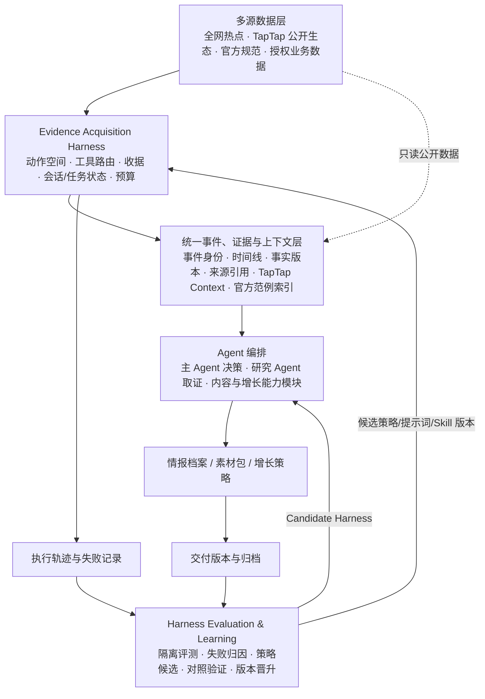

# V4 架构：TapTap Context-Aware Intelligence & Adaptive Harness

版本：冻结稿 v1.0（2026-11-13，北京时间）
状态：**设计冻结，实现分期**。本稿合并并取代 `docs/V4-架构草案.md` 的方向性讨论；
草案保留为时点材料。V3 生产链路继续运行，V4 采用渐进迁移，不做一次性重写。
适用范围：本仓库（TapTap 热点情报与素材系统）。不宣称 TapTap 官方立场或内部数据权限。

本稿只冻结架构与契约。已交付的实现是 Acquisition Harness 切片 1（[第 9 节](#9-首个纵向切片acquisition-harness-v01)）
与真实浏览器动态观察切片 2（[9.4 节](#94-切片-2真实浏览器动态观察阶段-2-第一项已实现部分)）：
前者结论仅限**合成冻结回放样本上的机制对照**，后者仅限**本地合成 HTML 页面上的真实
Chromium/Edge 机制验证**。哪些是设计、哪些是已实现、哪些尚未验证，在文中逐项标注；
模型自评、测试通过、样本命中都不能替代事实核验或真实运营验收。

## 0. 一页结论

系统的核心竞争力不是能调用多少个大模型，也不是用两个还是八个 Agent。它能否在真实、
动态、信息不完整的互联网环境中，**以可控成本持续获得可靠证据，并把这些证据转化为
适合 TapTap 的业务判断**，才是 V4 要证明的事。

本稿采纳上一轮讨论的四个判断，并各自落到工程约束：

1. **Playwright、Tabbit CLI、OCR、视觉模型都纳入能力池，但不默认全部调用。**
   Agent 提出研究目标，Harness 负责能力约束与执行管理；工具选择由二者共同完成。
   切片 1 已实现预算/能力复核与被拒动作的 `deferred` 收据；缺口级路由理由与
   完整候选解释字段尚未接入执行链路（见第 10 节限制），不以「每次选择理由都已进收据」宣称。
2. **现有 Skill 项目可以复用，且应保持独立。** `skillproof` 的录制、Skill 归纳、
   语义定位与完成验证可以以只读适配器接入；其完成验证器检查「页面操作是否完成」，
   TapTap 的独立验证器检查「是否获得真正支持结论的事实」，两者不能互相替代。
3. **不固守两个 Agent，也不盲目扩展多 Agent。** 核心职责保留，新增能力优先做成
   确定性模块或工具；只有确实需要独立规划、独立验收的部分才升级为 Agent，
   且是否升级由实验决定。
4. **Harness 是本次升级的核心工程体系，而不是又一个 Agent。** 它同时负责浏览器执行、
   状态、证据、上下文、评测与策略优化；策略可以学习，事实正确性、安全边界和数据
   权限不能由奖励函数修改。

每次研究任务的默认路径因此变为：

> 目标 → 取证动作（inspect / locate / extract / interact）→ 结构化收据与证据 →
> 独立核验 → 业务判断 → 交付版本 → 轨迹与失败归因 → 候选策略实验

## 1. 目标、非目标与验收标准

### 1.1 目标

面向 TapTap 社区运营，主动观察外部信息与内部情况，研究两者联系，分别交付有依据的
**情报**、可编辑**素材**和可测试的**增长创意**。V3 已覆盖其中一部分；V4 要补齐六项能力：

| 能力 | 要解决的问题 | 当前状态 |
| --- | --- | --- |
| 全网 + TapTap Context | 跨平台热点与站内公开生态、业务条件的结合 | V3 有部分采集与图谱；Context 未成体系 |
| 官方内容参考库 | 官方文章、活动案例、文案与视觉规范 | 尚未建设；批量采集待许可 |
| AI 热点脉络 | 同一事件识别、关系、传播时间线 | V3 有候选分组与图谱雏形，事件身份与时间线仍弱 |
| 时效性研究 | 主动补查、时间冲突、事实失效与替代 | V3 有时效检查与补查队列，未形成统一事实版本 |
| 自适应信息获取 | API、DOM、浏览器、OCR、VLM、Tabbit、Skill 按需组合 | V3 浏览器固定三屏 + 本地 OCR；切片 1 提供契约与策略层 |
| Harness 评测与优化 | 轨迹、失败归因、策略对照、Skill 复用、反馈 | V3 有 A/B/C 实验协议；V4 策略学习未开始 |

三项业务输出（情报、素材、创意）独立判断，不要求每条线索都产出三类成果；负面、
争议或关键依据不足的事件禁止包装成推广机会。这些 V3 纪律在 V4 中**不放松**。

### 1.2 非目标（本阶段明确不做）

- 不一次性重写 V3；不替换现有生产调度；不双写同一业务成果。
- 不宣称真实增长效果；没有授权的内部经营数据保持未知，不用推测填充。
- 不自动登录、不绕过验证码或平台访问限制；登录态只在用户明确授权的场景使用。
- 不把 OCR、视觉模型、页面截图或模型自评当作事实核验。
- 不建设分布式消息集群、常驻大规模 Agent 集群或默认开启的知识图谱。

### 1.3 验收标准（分四层，互不替代）

1. **事实与时效**：关键事实有可定位来源支持；日期区分发生、报道、采集与旧内容翻新；
   证据不足保持未知；旧页面版本不冒充当前事实。
2. **执行与证据**：每次工具调用返回结构化收据；失败、阻塞、预算耗尽如实记录；
   中断可恢复且不重复交付；页面版本变化后旧证据不得复用为当前事实。
3. **业务交付**：三类成果分别满足可编辑、可执行、有 TapTap 承接等标准；
   数量与结构完整度不算质量。
4. **成本与策略增量**：固定模型与冻结样本下，策略改动带来可复查的增量；
   资源指标单独报告，不混入质量评分，也不以少做困难任务换分数。

### 1.4 路线与验收原则（2026-11-15 补充）

V4 是**热点内容产品路线的证据底座升级**，不是独立的基础设施或平台项目。因此：

- 每个阶段的退出条件必须包含**业务可见交付**：至少一条情报/素材/创意，或对既有内容
  质量的可复查提升；测试数量、基础设施完成、机制评测本身不构成阶段完成。
- 工程实验（Harness、浏览器驱动、出网隔离、合成样本）是必要支撑，但不能替代业务验收；
  连续一个阶段没有业务交付时，应暂停扩展、回到内容主线。
- 真实外部页面试点必须绑定业务事件（与 TapTap 社区相关的游戏/活动/版本变化），
  非业务页面的管道试点只算工程验证，不计入 V4 阶段完成。
- 任何"接入生产默认路径"的决定，以真实业务事件上的证据增益与人工核查为前提，
  不以架构完整性或测试通过为前提。

## 2. 系统分层

图中的节点是**职责**，不代表 Agent 数量、固定执行顺序或必须拆成独立服务。
首期允许单服务、持久 SQLite 与本地证据文件。



分层约束：

- **Acquisition Harness 不决定业务价值**，只负责「以什么代价、用什么后端、拿到什么
  可核查证据」；业务判断属于 Agent 与业务契约。
- **证据层不依赖某个 Agent 的上下文**。研究分支通过稳定引用共享证据，汇总时可回到
  原始证据，避免只有摘要而丢失语境。
- **评测层在隔离环境中运行**，不进入实时业务链；候选策略只有通过冻结样本对照和
  未见任务复测后才能晋升。

## 3. 与 V3 的兼容边界

V4 采用绞杀者（strangler）方式：旧链路先照常运行，新层以契约接入，逐项替换，
每一步都可回退。迁移顺序由可验证的收益决定，不由目录新不新决定。

| 现有模块 | V3 现状 | V4 处置 | 条件与回退 |
| --- | --- | --- | --- |
| `agent_v3/` 主 Agent 与研究子 Agent | 生产运行：筛选、委派、工具预算、解读、交付 | **保留运行**，作为 V4 的首个执行器与对照基线 | V4 新能力通过适配层接入；出问题回退到 V3 链路 |
| `agent_v3/browser_tools.py`、`browser_worker.cjs`、`page_reader.cjs`、`comment_region.cjs` | 固定三屏截图 + 本地 Windows OCR；DOM 正文读取；评论区定位 | **保留为默认后端**；切片 1 提供回放适配，切片 2 新增独立的真实浏览器持久会话后端（`acquisition/live_driver.py`） | 动态驱动尚未替换 V3 生产调用方；替换前需在真实网站试点与人工核查 |
| `agent_v3/tool_executor.py` | 统一工具预算、审计、幂等边界 | **复用其约束思想**；V4 收据/会话属于新层 | 不迁移生产工具预算，避免双记账 |
| 证据、时效、补查、租约、幂等、来源版本守卫 | V3 已有并经过故障注入测试 | **保留**，V4 统一到证据版本契约（`page_version`） | 先新增只读视图；不重写生产表 |
| GraphRAG（自研图索引） | 默认关闭；两组对照未证明边际价值 | **保持默认关闭**（`V3_GRAPH_MODE=on` 可启用） | 继续用实验裁决，不因 V4 重新默认化 |
| 事件跟踪与候选分组 | 候选桶、标题归组、部分实体关系 | 演进为 **Event & Temporal Engine** 的确定性基础能力 | 语义合并先保守；跨事件 LLM 图谱增强仍可选 |
| `agent_v3/benchmark.py`、`docs/V3-可复现对照实验.md` | A/B/C 质量优先对照协议 | **复用实验纪律与冻结流程**；新增 V4 四臂对照 | 不替换旧协议；旧结果保留 |
| `webapp/`、`spatial/` | 查询接口与工作台 | **暂不迁移**；V4 成果先只读展示 | 前端无破坏性改造 |
| `data_source/`、`signals/`、`trend/`、`intelligence/`、`memory/`、`execution/`、`runtime/` | 分层六链与旧 harness | **保留**；新采集/证据能力经适配接入 | 不新增跨层双写 |
| `.github/workflows/ci.yml` | 分层单元测试 + 发布守卫 | 增加 `acquisition/tests` 发现 | 旧测试与守卫不削弱 |

迁移规则：

1. **契约先行**：任何替换先冻结数据契约（本稿第 4、5 节），再写适配器与对照。
2. **单写者**：同一业务成果只允许一个写入方；迁移期间用开关切换，不做双写。
3. **可回退**：新路径有独立开关与快照，失败回退不丢已采集证据。
4. **不降级守卫**：V3 的引用、日期、风险、租约、来源版本守卫在迁移中不得放宽。
5. **旧结果留档**：实验、失败与未运行项不删除、不倒填。

## 4. Acquisition Harness 契约（v0.1 已实现）

实现位置：`acquisition/`；契约版本 `acquisition-contract-v0.1`；冻结于
`acquisition/model.py`。本节描述设计，已实现部分见第 9 节。

### 4.1 动作空间

Agent 与 Harness 共享一个受约束的动作空间，不再给模型十几个互不相关的工具：

| 动作 | 做什么 | 相对成本单位 | 产出 |
| --- | --- | --- | --- |
| `inspect` | 读取页面结构、区域角色、阻塞状态、页面版本 | 1 | 页面观察（不产生证据） |
| `locate` | 在结构不明确时定位候选区域 | 1 | 候选区域列表（不产生证据） |
| `interact` | 点击/展开/滚动以触发懒加载后重新观察 | 2 | 新页面版本 + 新观察 |
| `extract` | 按 `dom` / `ocr` / `vlm` / `skill` 通道读取指定区域 | 1 / 3 / 5 / 2 | 收据 + 证据（`verified=false`） |
| `stop` | 停止并说明原因 | 0 | 停止原因与剩余缺口 |

成本单位是内部相对权重，用于预算约束与成本对照，**不是金额，也不是质量分**。
预算至少约束总单位、截图数、OCR 次数、VLM 次数与最大步数。VLM 与 Tabbit 默认关闭，
由配置显式启用。

### 4.2 统一收据

每次工具动作返回结构化收据，而不是一段自由文本。最小形态：

```json
{
  "schema": "acquisition-contract-v0.1",
  "receipt_id": "receipt_…",
  "idempotency_key": "receipt_…",
  "task_id": "research_001",
  "goal": "确认活动截止日期",
  "backend": "playwright",
  "action": "extract",
  "region": "activity_rules",
  "status": "completed",
  "page_version": "sha256:…",
  "evidence": [
    {
      "capture_id": "capture_001",
      "page_version": "sha256:…",
      "bbox": [120, 320, 800, 400],
      "extraction": "ocr",
      "verified": false,
      "note": "视觉转录，需对照截图与独立核验"
    }
  ],
  "cost": {"units": 3, "captures": 1, "ocr_calls": 1, "vlm_calls": 0},
  "next": "verify_against_source"
}
```

收据必须能回答五件事：哪个任务、用哪个后端、对哪个页面版本、做了什么动作、
得到什么证据与下一步。`next` 取 `verify_against_source`、`continue`、`fallback`、
`retry`、`stop`、`human_review` 之一。

**`verified` 的语义是事实核验状态，不是提取成功状态。** 截图成功、OCR 识别成功、
视觉模型读出一行字，都只把 `verified` 保持为 `false`；只有独立 verifier 核对页面
版本、引文位置与支持关系后才能置真，且核验记录不可删除、只能追加。存储层只允许
`store.verify(status='supported')` 置真、收据校验也会拒绝已核验证据回写；但引文是否
真正支持结论属于 verifier 的语义职责，是流程约定而非结构强制。策略层没有任何路径
可以绕过这条边界。

### 4.3 动态观察，而不是固定三屏

V3 的浏览器读取在视觉模式下固定截三屏（`browser_worker.cjs`：0、850、1700 像素
偏移，最多三帧），然后整页 OCR。它简单、可复现，但不知道「要找什么」，在懒加载、
长页面、纯图片规则和布局变化时要么漏读，要么为无关区域付费。

V4 的观察策略是目标驱动、可提前停止的：

1. `inspect` 读取页面结构与区域角色（正文、活动规则、评论、海报、表单、登录墙…）。
2. 按目标给区域排序：已通过完成验证的 Skill 先验 > 目标声明的区域角色 >
   文本候选 > 仅有视觉文字 > 其他。
3. 懒加载区域先 `interact` 再提取；DOM 可读优先 `dom`，只有纯视觉内容才 `ocr`。
4. 每个动作受预算约束，同区域同通道默认只尝试一次。
5. 停止条件：必答目标都有候选证据（交给独立核验，不等于已证实）/ 阻塞页 /
   登录墙缺口 / 预算耗尽 / 连续若干步没有新增有效证据。

策略只输出动作意图，**预算、权限与阻塞页面由 Harness 复核**。阻塞页面（验证码、
登录墙、拒绝访问）上的截图只能用于人工核查，不能进入证据库；这条不依赖策略自觉，
由执行循环统一拦截。

### 4.4 会话、任务与恢复

浏览器是有状态的执行环境，任务本身也必须是有状态的：

- 每个任务有稳定的 `task_id`；每次动作有幂等键（任务 + 页面版本 + 动作 + 区域 +
  提取通道）。失败或延后的动作重试使用独立的重试键并保留历史收据，不静默覆盖。
- 收据与证据先落库再返回；客户端断线、进程崩溃或响应丢失后，可按任务查询已完成的
  收据，而不是重复操作。
- 会话租约带 fence token；经 Harness 的收据、证据与任务终态写入会在同一个短事务内
  先复核 owner/token，跨租约接管的旧执行者不能覆盖新终态；写前续租心跳。直接调用
  store 写入仍信任调用方（纵深防御边界）；单个动作耗时超过租约 TTL 时仍可能失租，
  TTL 与后台续租在阶段 2 调整。
- 恢复时比较当前页面版本与已存证据版本：版本变化则判 `page_version_changed` 并停止，
  旧证据只作历史版本，不冒充当前事实；需要新版本时以新任务重新取证。
- 任务的 `succeeded` 表示执行正常结束**且** required 目标都有候选证据（召回级判断，
  不是语义覆盖，候选仍未经事实核验）；目标未覆盖或未知停止原因记为
  `failed`/`blocked` 并保留缺口，不把「跑完了」写成「研究目标达成」。
- Session 恢复**不保证外部页面没有变化**；检查点保存执行状态，证据快照保存所见内容，
  二者不能互相替代。

### 4.5 后端矩阵与选择约束

| 场景 | 优先 | 备用 | 约束 |
| --- | --- | --- | --- |
| 静态文章、公告 | HTTP / DOM | 浏览器正文读取 | 只读公开页面；记录读取范围 |
| 懒加载、动态页面 | Playwright | 视觉区域观察 | 有预算与步数上限 |
| 图片内的时间与规则 | OCR | VLM 辅助理解 | OCR 是转录，不是核验 |
| 复杂视觉界面 | VLM + GUI 操作 | 人工协助 | 默认关闭，需显式启用与成本核算 |
| 重复、已学习的网页流程 | Skill Provider | 通用 Playwright | 必须先通过完成验证门禁 |
| 用户授权的登录场景 | 受控会话 / 可选 Tabbit CLI | 授权数据导出 | 仅限授权范围；不绕过站点规则 |
| 禁止自动采集或无访问权 | 停止并记录缺口 | 合法替代来源 | 不猜测、不伪造 |

**Tabbit CLI 的定位是可选的浏览器后端，不是依赖。** 其公开资料显示它让 Codex 等
Agent 通过 Skill 使用 Tabbit 浏览器、复用已有登录状态（官方快速开始文档，2026-09）。
这验证了「保留浏览器状态 + Agent 提交任务 + 读回结果」的方向，但本项目不依赖它才能
运行：默认仍是 Playwright；Tabbit 适配只在环境具备、且用户授权时评估。复用登录态
不代表获得自动采集许可，站内内容仍受平台规则与实际授权约束。

### 4.6 Skill Provider 与双层验证

`skillproof` 是一个可独立检查的实际项目：录制一次浏览器操作，归纳为 `SKILL.md` +
`verify.json`，Agent 执行后用完成验证器检查结果；其公开结果包含固定回放基线
（录制页面 100/100，UI 改版后 25/100）与 Skill + 验证器在改版后仍 100/100 的对照。
它同时明确承认验证器局限：完成检查说过「不能确认」的部分，不等于任务做对。
（数字来自该项目 README 与复现脚本，属于其自建测试环境；本项目不把它当作真实网站
通用能力证明。）

V4 的接入边界：

```
skillproof（独立仓库，保持自己的研究定位）
   │ 只读适配：SKILL.md / verify.json / 结构签名
   ▼
Skill Registry ──门禁（host、平台规则复核、结构签名、权限）──► Hint Provider
   │                                                          │
   ▼                                                          ▼
完成验证器（流程是否完成）                        Acquisition Harness 的区域先验
   │
   ▼
TapTap 独立证据验证器（事实是否真的被支持）—— 与上面互不替代
```

- Skill 只能影响**观察顺序**（先看哪个区域），不能产生事实结论。
- Skill 完成验证通过，只说明录制流程的条件被满足；它不能把 `evidence.verified` 置真。
- 结构签名只覆盖区域角色序列：轻微布局变化仍可复用，主导航/规则区/评论区的消失
  或换位会拒绝复用并回退到通用策略。
- Skill 的归纳、复用与验证作为独立能力案例，在两个仓库分别保留实现与集成示例；
  不把 skillproof 整个并入本仓库。

### 4.7 权限、安全与证据留存

- 只读公开页面；不自动登录、不绕过验证码、不规避限流。
- 登录会话仅限用户明确授权的场景，记录授权范围；未授权时记录缺口并停止。
- 证据保存来源 URL、页面版本、读取范围、采集时间与提取通道；公开互动是采样观察，
  不代表全体玩家或真实增长。
- 截图、原文、评论与账号配置留在本地忽略目录；公开导出沿用 V3 字段白名单。

## 5. 统一事件、证据与上下文层

### 5.1 事件与时间（确定性服务优先）

- 事件身份、时间线、事实版本、过期检测属于基础能力，**默认持续工作**；它们是普通
  持久对象与确定性规则，不是昂贵的 GraphRAG。
- 旧事实验证后进入历史版本；依赖旧事实的假设与成果标记待复查，不直接推断全部错误。
- 同一事件的跨来源合并先保守：标题归组只做召回，语义合并需可撤回、记录依据。
- 跨事件 LLM 图谱增强仍是**可选功能**，待对照实验证明边际价值后再启用；V3 的
  「默认关闭」结论在 V4 不撤销。

### 5.2 TapTap Context

- 公开观察（榜单、评价、社区讨论、产品入口）与运营提供的信息分别标注来源类别。
- 内部经营数据须有授权来源；未取得时保持未知，不用模型猜测补全。
- Context 按任务检索，不默认塞入全部数据；上下文、调用、耗时与费用边界可配置并记录。
- 官方内容参考库先纳入公开指南与人工整理的原创结构规范；批量自动采集等待许可。

### 5.3 领域对象

沿用在 V4 草案中已列出的语义边界：证据与快照、TapTap Context、事项、价值假设、
研究任务、成果与版本、案例与反馈。V4 新增的只有执行层对象：任务、会话、收据、
证据、核验记录与 Skill 版本。**证据失效或更正后，依赖它的成果进入待复查，
不自动删除，也不自动判定全部错误。**

**已实现 MVP（2026-11-15，`context/`）**：事件身份与 append-only 版本、事实与逐字引文、
页面版本变化后的过期检测（旧引文在新版本消失即标 stale）、时间线，以及只由公开
HTTP 原文/已核对引文生成的 Context Card（平台/日期/价格/unknowns/相关性判断）。
另实现同游戏多来源分组（`game_key`、`group_detail`）与日期/价格**冲突候选**列表；
冲突只表示不同来源文本原子不一致，不判定谁正确。已用 2 篇 THE FINALS 公开报道
跑通分组 demo（2 事件、16 条去重事实、无冲突；冲突由合成测试覆盖），全部 Beam、
LongCat 0 次。
新增 `context/event_match.py`：同组内 same-event 候选（标题/日期/引文重合）与
fact-conflict 候选（文本相似但数字/日期原子不同），只给候选，不自动合并、不裁决。
真实两篇 THE FINALS 报道（赛季 vs 反作弊）报告 0 候选；阳性 case 由 6 个合成测试覆盖。
真实第二来源受 Cloudflare/网络限制未取得；用同一真实正文+改写标题的**合成第二来源**
验证：同组检测出 1 个 same-event 候选（分数 0.55，日期重合 1.0、引文相似 1.0），
合成来源在报告中明确标注，不能引用。
另加“发布日期邻近”信号与元数据-only 来源登记（`add_event_stub`）：真实 3DM 全文 +
Steam 新闻 API 观察到的标题/日期（正文多次抓取超时）得到 1 个跨语言元数据候选
（score 0.35，发布日期邻近 1.0，metadata_only=true，auto_merge=false）；不能当作
已验证的第二全文来源。
跨语言同事件的语义匹配已实现**可插拔接口**（`context/embedding.py`）：调用方注入
多语言 embedder，按标题+引文向量余弦生成候选，默认不配置、不发外部请求；设计、
方案比较与评测计划见 [多语言同事件匹配](V4-多语言同事件匹配.md)。当前只有假
embedder 单元测试，没有真实跨语言全文对。它不写 V3 生产表、不做 LLM 语义
事件合并、不启用 GraphRAG；Context Card 与分组都是启发式，不是事实核验。

### 5.4 交付层与共享前端（MVP，2026-11-23）

交付层不属于 V3 页面；前端是 **共享前端**，V3 与 V4 都只是向它提供成果数据。

- `context/delivery.py`：固定三类型交付包 `intelligence` / `material` /
  `growth_creative`，含来源、引文、unknowns、质量检查与增长创意前置条件；
- `scripts/v4_delivery_pack.py`：从已有事件包组装交付包、`index.json` 与本地预览；
- `webapp/main.py`：`GET /api/v4/deliveries` 与
  `GET /api/v4/deliveries/{event_id}` 只读接口，数据目录 `V4_DELIVERY_DIR`
  （默认 `data/v4/deliveries`）；
- 增长创意已接入 TapTap 参考库（近期样本 + 原创结构模式，
  `context/reference_library.py`），并可用模型生成（`context/creative_model.py`）；
  模式按事件关键词选最高分，模型只从已选模式声明实际使用者；输出受字段/数字/
  参考长文校验，质量门槛进入交付总检查，失败回退确定性草案；
  未发布、未做独立事实核验。
- 已完成第一个真实 TapTap 公开事件 MVP（鹅鸭杀×葫芦兄弟联动）：4 条事实、
  4/4 引文、3 类型交付、3 个参考模式/3 个来源，质量检查全过；共享前端 API
  可读 `data/v4/deliveries/index.json`，共享前端新增「V4 交付」页签；远端 Pages
使用 `spatial/public/v4-deliveries/` 静态导出（由 `scripts/export_v4_deliveries_public.py`
生成，剥离 usage 等内部字段）。

## 6. Agent 组织：动态 Agent + 能力模块

| 角色或模块 | 职责 | 是否独立 Agent |
| --- | --- | --- |
| Intelligence Orchestrator | 判断事件价值、业务目标、任务委派、最终验收 | 保留（主 Agent） |
| Research Agent | 证据缺口分析、检索规划、来源核实 | 保留（研究 Agent） |
| Acquisition Harness | 后端选择、预算、收据、会话、证据落库、恢复 | 否（确定性模块） |
| Event & Temporal Engine | 事件聚合、时间线、事实版本、过期检测 | 否（先做确定性服务） |
| TapTap Context Engine | 检索公开平台数据、业务知识、官方规范 | 否 |
| Content & Growth Worker | 情报、素材、创意的专业化生成 | 初期为任务模块；已有条件修复编排 MVP，不升级为独立 Agent |
| Skill Registry / Verifier | Skill 完成验证与复用门禁 | 否 |
| Evaluation & Improvement | 轨迹评分、失败归因、策略试验、版本晋升 | 否（离线 Harness） |

升级为独立 Agent 的条件（全部满足才考虑）：

1. 该职责需要独立的多轮规划，且与主 Agent 的上下文裁剪会明显损害质量；
2. 现有单 Agent 或确定性模块在同一冻结样本上出现可归因的重复失败；
3. 独立化后能在固定模型、冻结样本下证明质量或成本增量，并保留回退路径。

不因为 Multi-Agent 更流行而拆分，也不为了「架构好看」增加交接损耗。

## 7. Evaluation & Learning

### 7.1 反事实基线

必须保留强基线：**强模型直接读取相同证据，能不能做得一样好？** 至少四臂：

| 对照 | 能证明什么 |
| --- | --- |
| 强模型 + 全网资料 | 基础能力 |
| 强模型 + 全网 + TapTap Context | 平台上下文的增量 |
| 相同模型 + Context + 固定 Harness | 执行、证据与状态管理的增量 |
| 相同模型 + Context + 自适应 Harness | 工具策略与优化的增量 |

分别报告事实质量、时效准确性、合格交付率、工具成本与业务适配性；真实增长效果
另行评估，不能以模型自评分替代。冻结样本、模型、提示词、工具集与评测规则；
所有失败、暂缓、未执行与未核实结果保留。

### 7.2 可学习的策略对象（先做小规模受控实验）

| 策略对象 | 需要回答的问题 | 评价依据 |
| --- | --- | --- |
| Tool Router | 什么时候选 DOM、OCR、VLM、浏览器 Skill | 证据获取成功率、成本 |
| Observation / Screenshot Policy | 看哪里、截几张、何时滚动、何时停止 | 有效事实增益、截图数 |
| Context Policy | 给 Agent 哪些 TapTap 业务上下文 | 事实覆盖、业务适配 |
| Temporal Policy | 什么时候重新查询旧事件 | 过期事实误用、更新召回 |
| Skill Selector | 哪个网页操作 Skill 值得复用 | 页面变化后的任务完成率 |
| Model Router | 哪个任务值得调用强模型 | 质量、延迟、费用 |

流程：旧策略运行 → 从轨迹找失败 → 生成一个候选改动 → 用固定样本对比 →
保留真正有收益的改动 → 在未见任务复测。借鉴 Harness² 的
**Propose–Probe–Compose** 思想（候选修改 → 执行探测 → 组合有效改动），
但不直接移植整套框架：其执行器面向 OpenCode/Codex 等编程 Agent，本项目的任务状态、
数据权限与验收机制不同，整包移植会把外部假设带进来。

### 7.3 学习边界（不可协商）

- 策略可以学习；**事实正确性、安全边界、数据权限和评测规则不能被奖励函数修改**。
- 不能通过少处理困难任务、放宽引用标准、拒绝所有输出或删掉失败样本提高分数。
- 每次采用与回滚都有版本记录；候选优化使用训练/开发任务，留出任务不参与选择。
- 真实数据更新另设时间窗口，检查泛化与来源漂移。

### 7.4 已实现的自动评估 MVP（2026-11-15）

`context/evaluate.py` 对业务事件包做确定性代理评分：逐字引文支持率、事实文本中
未在原文字面出现的数字/日期、素材字段完整性、unknowns 数量、Context Card 覆盖；
`context/` 同时提供事件版本与 stale 计数。它不调用模型、不判事实真假。

首个 Propose–Probe–Compose 小实验（3 个冻结事件、Beam only、LongCat 0 次）比较
「仅证据」与「证据 + Context Card」两种提示：初版候选事实数 30→21，按预先规则
「事实覆盖不得下降」被拒绝；改进 Context 抽取与提示（要求事实不少于基线、Context
只作重点）后复测：基线 25 条、候选 35 条，引文支持均 100%、未支持数字 0、素材完整
3/3、unknowns 22→21，候选通过全部预注册门槛。因此作为**可选** `--context-card`
接入业务事件包，默认不开启。随后的 LongCat 最终稿验证（1 事件、1 次调用）返回
无效 JSON，验证失败且未重试；Context Card 目前只通过了 Beam 实验门槛，
**默认仍走基线最终稿**，失败记录保留。

**动态编排 MVP（`context/orchestrator.py`，2026-11-15）**：草稿 → 确定性质量门槛
（事实数/引文/未支持数字/素材）→ 仅在门槛失败且预算内委托一次修复 → 复检；
只有全部门槛通过的草稿才允许调用最终模型。3 个冻结事件、Beam only、LongCat 0 次：
2 个事件触发 1 次修复（事实 5→9、6→8），1 个事件草稿直接通过（14 条）；3/3
达到 `ready_for_final`，无 `needs_review`。这是"按需委派"的最小实现，不是 Multi-Agent；
修复效果只在代理指标上成立，未做事实核验。

编排器已接入业务事件包（`--orchestrate`，可选）：先草稿、过门槛、失败时最多一次
修复；只有通过门槛才写 accepted/final。3 事件实跑时 Beam Free 返回 HTTP 403
`RegionError`（该模型在当前地区不可用），0/3 交付，失败保留；没有自动切换到
Iceman（训练条款）或 LongCat（配额），也没有重试。

Beam 仍不可用时，用 Iceman 做草稿/修复（公开页面内容，标注训练条款）重跑编排：
3/3 `ready_for_final`（各 1 次修复，8/9/8 条事实）。随后以新的预注册批次
`iceman-longcat-min6-v1` 验证 LongCat 最终稿（min_facts=6，1 次调用）：
草稿 8 条直接通过，LongCat 最终稿 8 条、8/8 引文、未支持数字 0、素材完整，
首次 `final_delivered`。旧 min_facts=8 的失败保留，不回改。 随后用同一预注册策略扩到 3 个冻结事件：3/3 `final_delivered`，
无修复，事实 6/7/8，引文全部支持；LongCat 共 3 次调用。

随后做 1 次 LongCat 最终稿验证（同一事件、只 1 次调用、不重试）：草稿被门槛拒绝，
1 次修复后通过；LongCat 最终稿只有 6 条事实（< 预注册的 8 条），虽然引文 6/6、
未支持数字 0、素材完整，仍被判 `needs_review`，没有放宽门槛。LongCat 累计约 6 次。

另开 `min_facts=6` 的预注册批次复验：v1 在 Beam 草稿请求阶段 ConnectionError，
v2 的 Beam 草稿通过（7 条事实、7/7 引文、素材完整）但 LongCat 请求阶段 ProxyError，
两次都未返回模型输出；LongCat 验证仍 **inconclusive**，不记为通过或失败，也未再重试。

## 8. 路线图与验收

| 阶段 | 内容 | 退出条件 |
| --- | --- | --- |
| 阶段 1（本次） | 冻结 V4 架构与兼容边界；交付 Acquisition Harness 切片 1 | 架构文档冻结；切片在冻结样本上可复现；V3 测试与 CI 不回退 |
| 阶段 2 | Playwright 动态观察成为默认截图路径；接入可选 VLM；评估 Tabbit CLI 适配；Skill 在一个重复且获许可的网页读取任务上试点 | 相同页面集合下，动态策略比固定三屏获得更多可定位证据，且成本可控；真实网页试点保留全部失败 |
| 阶段 3 | TapTap Context 与事件时间线；官方参考库首批人工规范 | 同一事件能关联外部信息与站内语境；旧事实更新被正确处理 |
| 阶段 4 | 四组任务评价（信息获取、热点脉络、时效性、业务交付）与策略学习 | 固定模型、冻结样本下，策略改动而非模型升级带来可复查收益；留出任务复测 |

每阶段仍然遵守 V3 的诚实口径：没有对照就不写「优于」，没有授权就不写「已接入」，
没有人工核查就不把自动检查称为事实金标。阶段完成以业务交付为准（见 1.4），
工程验收只是必要条件，不是充分条件。

阶段 2 的第一项（真实浏览器持久会话 + 动态观察驱动 + 本地真实浏览器验收）已完成，
见 [9.4 节](#94-切片-2真实浏览器动态观察阶段-2-第一项已实现部分)；真实外部网站试点、
可选 VLM、Tabbit CLI 适配与跨任务会话池仍未开始。

## 9. 首个纵向切片：Acquisition Harness v0.1

### 9.1 交付范围（已实现，2026-11-13）

| 模块 | 内容 |
| --- | --- |
| `acquisition/model.py` | 冻结契约：任务目标、页面观察、动作、收据、证据、核验、预算、轨迹 |
| `acquisition/driver.py` | 回放驱动（按现有 `browser_worker.cjs` 页面结构）；V3 固定三屏输出的离线转换适配 |
| `acquisition/receipts.py` | 收据构造与校验：阻塞页不得携带证据、`verified` 必须记录 verifier |
| `acquisition/store.py` | SQLite 持久化：任务、会话、收据、证据、核验、租约与恢复 |
| `acquisition/harness.py` | 唯一执行循环：预算、幂等、阻塞页面拦截、页面版本 stale 判定、轨迹 |
| `acquisition/policy.py` | 固定三屏基线、现状 V3 基线、自适应观察策略 |
| `acquisition/router.py` | 按证据缺口与能力约束选择后端，记录选择与被拒理由（`route()` API 已有；执行链路目前只调用 `validate_action`，缺口级理由写入收据属阶段 2） |
| `acquisition/skills.py` | skillproof 风格 Skill 注册、结构签名门禁、完成验证（不置事实真值） |
| `acquisition/evaluate.py` | 冻结样本上的四策略离线对照与检查项 |
| `acquisition/cli.py` | 单任务轨迹演示入口（`python -m acquisition.cli`） |
| `acquisition/fixtures/` | 合成冻结页面样本与 Skill 样例（非真实站点录制） |

切片**不修改** `agent_v3/`、`spatial/`、`webapp/` 的任何行为，也不接入生产调度。

### 9.2 评测设计与口径

- 对照四策略：`legacy_v3`（DOM 正文 + 固定三屏，现状行为）、`fixed_frames`
  （仅固定三屏，被替换的截图策略）、`adaptive`（动态观察）、`adaptive_skill`
  （合法 Skill 先验）。
- 样本：7 个合成冻结页面，覆盖静态正文、懒加载规则、纯图片海报、布局改版、
  登录墙评论与验证码阻塞。
- 指标：命中冻结样本预期答案（只证明机制，不证明事实核验）、是否定位到语义区域、
  截图/OCR/成本单位、停止原因、阻塞页证据泄漏、证据核验状态；任务终态区分
  「执行正常结束且目标有候选证据」与「未覆盖/阻塞」，不把跑完写成目标达成。
- 检查项共 23 项且运行前固定（见 `acquisition/evaluate.py` 与内部接口冻结记录）：
  样本完整性、四策略命中与语义定位（含 `layout_changed_v1/v2` 各自独立的
  beats/located 检查）、成本与预算、阻塞页零泄漏、登录缺口、Skill 门禁与双层验证、
  确定性、样本真值不泄漏。结果同时保留失败与未命中，不挑选样本。

### 9.3 已得出的结论与未证明事项

复现命令：`python -m acquisition.evaluate --fixtures acquisition/fixtures/pages`。
评测产物保存在本地 `docs_local/evaluations/`（不随公开仓库发布）。以下结论只适用于
这 7 个**合成冻结样本**：

- **动态观察补上了固定截图的漏读**：在懒加载规则、纯图片海报、布局改版 v1/v2 四类
  样本上，`adaptive` / `adaptive_skill` 命中预期答案且证据可定位到语义区域；
  `fixed_frames`（仅固定三屏）与 `legacy_v3`（整页 DOM + 固定三屏）均未命中。
  四类样本都有独立的 beats/located 检查项。
- **成本方向符合预期**：静态正文样本上 `adaptive` 用 2 个成本单位、0 次截图，
  `legacy_v3` 用 11 个成本单位、3 次截图；懒加载样本上自适应是「交互 2 + DOM 1」
  的动作组合，没有为无关区域截图。
- **阻塞页安全边界由执行循环保证**：验证码样本上四种策略证据泄漏均为 0；
  固定基线在失败前多付 1 次截图，自适应在 inspect 后即停止。
- **登录墙记录为缺口而不是伪造证据**：评论区样本上自适应返回
  `login_required` 缺口，评论证据为 0。
- **恢复与版本语义**：中断后恢复不重复执行已完成动作、预算边界下与全新运行等价；
  页面版本变化时判 `page_version_changed`，旧证据保留为历史版本；跨租约接管的旧
  执行者不能覆盖新终态（集成测试覆盖）。交互重放仍未实现（见第 10 节）。
- **成功语义**：未覆盖 required 目标的任务记为 `failed` + `objectives_uncovered`；
  现状 V3 基线在静态样本命中记为正常结束，在懒加载样本未命中记为未覆盖。覆盖判定
  使用召回式 `candidate_text`（不依赖区域角色），是执行完成判据而非语义覆盖——
  例如登录提示文字也可能被算作候选，仍需人工或独立 verifier 判断证据是否真的支持结论。
- **Skill 双层验证边界成立**：合法结构签名与站点白名单下 Skill 可用，签名变化
  或域名不符时拒绝；Skill 流程完成验证通过后 `Evidence.verified` 仍为 `False`。
  但**本轮 Skill 先验没有降低动作成本**（与纯自适应相同），复用收益尚未证明。
- **测试与复核**：切片 1 相关机制检查 254 项（当时全量）通过；evaluate 23/23 检查通过；
  V3 抽查与分层回归、发布守卫不回退。交付前由未参与实现的 reviewer 做过独立复核，
  修复了恢复步数、租约 fence、重试收据、成功语义、`driver.open` 异常等问题；
  复核报告在内部记录中，不随公开仓库发布。加入切片 2 后 `acquisition/tests` 全量
  358 项（见 9.4）。

**不能说的**：

- 不能声称真实网页上的采集成功率、事实准确率或成本收益；
- 不能声称 Skill 泛化到未见过站点，或 Skill 验证器能证明事实正确；
- 不能声称 V4 优于 V3 整体架构——本切片没有对业务交付做对照；
- 不能把测试通过、样本命中或结构完整当作运营可用性或增长效果。

### 9.4 切片 2：真实浏览器动态观察（阶段 2 第一项，已实现部分）

实现位置：`acquisition/browser_session_worker.cjs`、`acquisition/live_driver.py`、
`acquisition/live_acceptance.py`、`acquisition/fixtures/live/`。**不修改** `agent_v3/`
现有浏览器工具与生产调用方。

复现：`python -m acquisition.live_acceptance --fixtures acquisition/fixtures/live`；
产物保存在本地 `docs_local/evaluations/`（不随公开仓库发布）。

- **持久浏览器会话**：Node + Playwright/Edge worker 一次启动，多个
  `open/navigate/observe/extract/screenshot/interact` 命令复用同一浏览器；验收断言
  `session_launches=1`。这是「浏览器是有状态执行环境」的第一个真实实现。
- **动态观察**：从真实 DOM 推断语义区域（正文、规则、评论、海报、登录墙、验证码）；
  懒加载区域先点击展开再读取；纯图片区域定点截图后 OCR；`visual_only` 区域不预置任何
  伪造文本。OCR 只做空白归一（合并数字/汉字间多余空格），证据 note 记录
  「视觉转录，需对照截图与语义核验」，OCR 不可用时返回空文本而不造假。
- **安全边界**：默认且本次验收使用的本地夹具模式通过内部固定 URL 导航加载 HTML，
  拦截全部 HTTP(S) 请求，并在页面内禁用 WebSocket/EventSource/WebRTC/sendBeacon、
  用 Playwright `routeWebSocket` 关闭连接（live checks 含「夹具模式 WebSocket 不得
  连到本机监听端口」负例）。这是进程内纵深防御，不是 OS 级网络命名空间隔离。
  URL 模式（公网 HTTPS）在 API 中**默认关闭**，必须显式 `allow_network=True` 才可用；
  已实现初始地址与逐请求的公网校验（拒绝非 HTTPS、凭据、非常规端口、非公网解析、
  隐藏视频、丢弃弹窗、无用户 profile/cookie）。已知限制：独立复核发现，公网页面
  301 重定向到私网地址时，浏览器可能在拦截生效前发起 TCP/TLS 连接尝试（内容未读取，
  但流量已到达目标端口）。因此 URL 模式未做对抗性出网隔离，真实外部网站试点前必须
  增加代理/防火墙/容器级网络隔离；当前不宣称 URL 模式对恶意重定向安全。
- **本地真实浏览器验收**（5 个合成 HTML × 3 策略；本机 Edge 157 + Playwright +
  Windows OCR，全部真实运行未 skip）：

| 场景 | fixed_frames（仅固定三屏） | legacy_v3（DOM + 固定三屏） | adaptive（动态观察） |
| --- | --- | --- | --- |
| static_article | 命中，7u/2cap | 命中，8u/2cap | 命中且可定位，2u/0cap |
| lazy_rules（按钮展开规则） | 未命中，10u/3cap | 未命中，11u/3cap | **命中且可定位，interact=1、2 个页面版本**，5u/0cap |
| poster_text（图片内日期，第三屏之外） | 未命中，10u/3cap | 未命中，11u/3cap | **定点截图 + OCR 命中**，4u/1cap |
| captcha（安全验证） | 证据 0，浪费 1 次截图 | 证据 0 | 证据 0，captures=0，`blocked:captcha` |
| login_comments（评论区需登录） | 证据 0 | 证据 0 | 证据 0，`gap=login_required` |

- 24 项运行前固定的 live checks 全部通过（含截图文件/ sha256 / 路径、证据版本绑定、
  两次运行页面版本稳定、会话复用、夹具模式 WebSocket 负例、预算与零泄漏）；
  `acquisition/tests` 全量 358 项通过。
- **不能说的**：这些页面是本地合成 HTML，不是真实网站；不代表真实网站采集成功率、
  反爬/登录可用性、OCR 准确率、事实正确性或增长效果。外部网站试点需单独授权、
  人工核查并保留全部失败，本切片未执行。
- **尚未做**：真实 Playwright 驱动替换 V3 生产默认路径、外部网站试点、可选 VLM、
  跨任务共享会话池、交互重放、Tabbit CLI 适配（这些仍属阶段 2 后续）。

### 9.5 切片 3：出网隔离与外部试点（首轮已运行，人工核查待完成）

承接切片 2 复核发现的 URL 模式盲连接问题，本切片把 URL 模式改成**默认关闭的
固定页面授权模式**，并完成第一轮真实外部页面运行：

- **本地过滤代理**（`acquisition/egress_proxy.py`）：只接受 `CONNECT host:443`；
  host 必须命中固定 allowlist（精确或子域）；解析一次、校验**所有** IP 为公网后
  直接连接已验证 IP（防 DNS rebinding，不做二次 DNS）；非 CONNECT/非 443/私网/
  非 allowlist 一律拒绝；所有允许与拒绝都记录 host、解析 IP、字节数与原因。
- **Chromium 强制走代理**：`--proxy-server`、`--proxy-bypass-list=<-loopback>`、
  `--disable-quic`、`--force-webrtc-ip-handling-policy=disable_non_proxied_udp`、
  `--disable-features=PreconnectToSearch,NetworkPrediction`；页面内继续禁用
  WebSocket/EventSource/WebRTC/sendBeacon，`routeWebSocket` 全部关闭；worker 在
  URL 模式缺少代理时直接拒绝启动。
- **URL 模式 API 收紧**：必须同时显式 `allow_network=True` 与提供
  `egress_allowlist`，否则拒绝；fixture 模式保持不变（默认路径）。
- **首轮外部试点**：固定 3 个公开、无需登录、内容稳定的页面
  （example.com、IANA example-domains、RFC 2606），每页 adaptive 与两条基线各跑一次：
  9/9 运行完成、加载失败 0、阻塞 0；egress 记录 allowed=10、denied=63（被拒绝的
  多为浏览器自身遥测/搜索域名，说明 allowlist 生效）；证据 16 条，全部 `verified=False`。
  报告逐页保留 51 项失败/缺口（如无语义区域、egress 拒绝），不重试到成功、不剔除页面。
- **口径**：结论只限「出网隔离与驱动在指定公开页面上是否按设计工作」；页面内容、
  人工核查项（目标语义区域是否读到、证据是否可定位、阻塞判定是否正确）均留待人工判定；
  不提供采集成功率、事实正确率、OCR 准确率或平台适配结论。原始页面正文不提交仓库，
  只在本地产物中截断保存。

### 9.6 切片 4：事件/时间线/Context 与自动评测（2026-11-15，MVP）

实现位置：`context/`（`engine.py`、`evaluate.py`、`tests/`）；消费
`scripts/business_event_pack.py` 产出的业务事件包，不改 V3 生产库。

- **事件与版本**：3 个真实事件、3 个页面版本、26 条事实；页面版本变化时，旧引文
  在新正文中消失即标 `stale`，并写入时间线；重复 ingest 幂等。
- **Context Card**：从已核对引文抽取平台/日期/价格、保留 unknowns、给出明确标注为
  「判断不是事实」的 TapTap 相关性假设；不写内部数据、不做 LLM 事件合并。
- **自动评估**：引文支持率、未在原文出现的数字/日期、素材字段完整性、unknowns、
  Context 覆盖、stale 计数；全部确定性，不调用模型。
- **策略实验（两轮）**：初版 Context 提示事实数 30→21，被预注册规则拒绝；改进
  Context 抽取与提示后复测，基线 25 条、候选 35 条，引文支持均 100%、未支持数字 0、
  素材完整 3/3，候选通过全部门槛。已作为**可选** `--context-card` 接入业务事件包，
  默认不开启。随后 LongCat 最终稿验证（1 次调用）返回无效 JSON，失败保留、不重试；
  Context Card 仍只算 Beam 实验通过。Beam 共 12 次、LongCat 1 次。
- **不能说的**：Context Card 的抽取是启发式，平台/日期/价格可能来自相关推荐或
  非同句内容；这不是 TapTap 内部 Context，也不是事实核验。事件关联、跨来源合并、
  GraphRAG 与动态 Agent 仍未实现。

### 9.7 切片 5：条件修复编排 MVP（2026-11-15）

- 实现：`context/orchestrator.py` + 7 个离线测试；
- 流程：Beam 草稿 → 预注册门槛 → 失败时 1 次有界修复（同一模型）→ 复检 →
  可选最终模型（本实验不调用 LongCat）；
- 结果：3 事件中 2 次修复（事实 5→9、6→8），1 次草稿直接通过（14 条）；
  3/3 `ready_for_final`，0 次 `needs_review`，Beam 5 次、LongCat 0 次；
- LongCat 最终稿验证（min_facts=8，1 事件、1 次调用、不重试）：修复后草稿通过，
  但 LongCat 最终稿只有 6 条事实（< 预注册的 8 条），引文 6/6、未支持数字 0、
  素材完整，仍判 `needs_review`；未放宽门槛，失败保留；
- min_facts=6 的另开预注册批次：v1/v2 均在模型请求阶段遭遇 ConnectionError/
  ProxyError，未返回模型输出；LongCat 验证 inconclusive，不记为通过或失败，未再重试；
- 已接入 `business_event_pack.py --orchestrate`（可选）；Beam 区域受限时用 Iceman
  重跑 3 事件：3/3 ready_for_final（各 1 次修复，8/9/8 条事实）；
- 模型预检/路由：`scripts/model_preflight.py` + `context/model_router.py`；实测
  hy4/beam ok、iceman skipped；编排 trace 记录 route 与传输失败回退；业务包
  `--auto-model` 实跑 3/3 ready_for_final（hy4，事实 11/11/7，0 修复，LongCat 0）；
- auto-model + 1 次 LongCat 最终稿（单事件、不重试）：hy4 草稿 8 条通过，LongCat
  最终稿 8 条、8/8 引文、素材完整，`final_delivered`，闭环完成；
- 扩到 3 事件（每事件最多 1 次 LongCat）：3/3 `final_delivered`，事实 7/10/13，
  LongCat 3 次；旧 min_facts=8 失败保留；
- 离线回放 Context Card 对照（同 hy4、同门槛、缓存证据）：第一轮 baseline 23 条、
  context 35 条；重复轮 baseline 27 条、context 0/3（空 content/截断），**增益未复现**；
  max_tokens=24000 后两组各 2/3（成功事件 context 各多 3 条，COD 均空 content），
  提高预算未消除 hy4 空输出；两轮结果均保留，不晋升 Context 提示；
- 事件层新增同事件/事实冲突候选：确定性规则，只给候选不自动合并/裁决；真实
  两篇 THE FINALS 不同主题报道 0 候选；合成同事件来源命中 1 个候选（0.55）；
  真实 3DM + Steam 元数据得到跨语言元数据候选（0.35，metadata_only）；
  第二真实全文来源因 Cloudflare/网络未取得；
- 跨语言语义候选接口（embedding）已实现但**未配置真实模型**；只有假 embedder
  测试，不能声称跨语言匹配已可用；
- 已接入 `business_event_pack.py --orchestrate`（可选）；Beam 区域受限时用 Iceman
  重跑 3 事件：3/3 ready_for_final（各 1 次修复，8/9/8 条事实）；
- 新预注册批次 `iceman-longcat-min6-v1`（Iceman 草稿 + LongCat 1 次最终稿）：
  8 条事实、8/8 引文、未支持数字 0、素材完整，首次 `final_delivered`；
  同策略扩到 3 事件后 3/3 `final_delivered`（6/7/8 条事实，0 修复，LongCat 3 次）；
  旧 min_facts=8 失败保留，门槛没有被回改；
- 2026-11-18 新增 `hy4-flash-free`（免费、可用、cost=0）对照：同一 3 事件包、
  `min_facts=6`，baseline 2/3 交付（THE FINALS 7 条、COD 8 条；初音 JSON 截断），
  context 1/3 交付（THE FINALS 12 条、12/12 引文；初音/COD 连接中断）。
  失败类型不同、未重试，因此只能报告单事件现象，不能声称 Context Card 普遍增益；
  hy4 的稳定性不足，仍保留失败。

**模型预检/路由 MVP（2026-11-18）**：`scripts/model_preflight.py` 对候选模型做一次
小 JSON 健康检查（不调用 LongCat）；`context/model_router.py` 按能力/策略选择第一个
健康候选，并把 route 与运行期回退写入编排 trace。实测：hy4-flash-free=ok（11.3s）、
beam-free=ok（7.2s）、iceman 因训练条款 skipped；路由 demo 在候选顺序把 Iceman 放首位时
正确跳过，选择 hy4，草稿 8 条事实、8/8 引文、`ready_for_final`（LongCat 0、Iceman 0）。
一次 hy4 连接中断的旧 trace 保留；运行期回退只在传输失败时换下一个健康模型，
不处理语义质量。
已接入业务包 `--auto-model`：3 事件实跑预检 hy4=ok、beam=403，自动选择 hy4；
3/3 `ready_for_final`，事实 11/11/7、引文全部支持，0 修复，LongCat 0。
随后在单事件上只加 1 次 LongCat 最终稿（不重试）：auto-model 选 hy4，草稿 8 条直接
通过，LongCat 最终稿 8 条、8/8 引文、素材完整，`final_delivered`，完成
「预检→路由→编排→最终稿」的首次闭环。 随后扩到 3 事件（min_facts=6，每事件最多 1 次 LongCat）：
3/3 `final_delivered`，事实 7/10/13、引文全部支持，0 修复，LongCat 3 次。
另用缓存证据回放（`--replay-dir`）隔离抓取波动，做同模型 Context Card 对照：
第一轮 baseline 3/3（事实 7/9/7），context 3/3（事实 12/11/12），合计 23→35；
但重复一轮后 baseline 3/3（27 条），context **0/3**（最终稿空 content / reasoning
截断）。因此 23→35 **没有复现**，不能声称 Context Card 稳定提高事实覆盖；
两轮失败与成功均保留，未调用 LongCat。
再把 `max_tokens` 从 12000 提到 24000（只改这一变量）：baseline 2/3（成功事件 7/8），
context 2/3（成功事件 10/11）；COD 在两组都因最终稿空 content 失败。提高预算没有消除
hy4 的空输出问题；两组成功事件上 context 多 3 条事实，但仍是单次结果，不能晋升。

- 限制：min_facts=6 是更低门槛；Iceman 允许训练、仅用公开内容；代理指标不等于
  事实核验；LongCat 未做多次稳定性验证；未做自动发布。

### 9.8 切片 6：V4 业务交付 MVP（TapTap 公开事件，2026-11-23）

- 事件：TapTap 公开观察帖《葫闹来了？鹅鸭杀联动爆料，居然是葫芦娃》；
- 参考库：5 条 TapTap 公开样本 + 5 个项目原创结构模式，只迁移结构/节奏，
  不复制原文/画面，不是官方规范；
- 交付：情报（4 条事实、4/4 逐字引文、3 条 unknowns）+ 素材 + 增长创意
  （官宣三件套/童年回忆切入/玩家问题式互动，记录 3 个来源 URL 与授权提示）；
- 交付契约：`v4-delivery-v0.1`、`index.json`、共享前端
  `GET /api/v4/deliveries`；本地交互预览已生成；
- 增长创意已用 `hy4-flash-free` 生成并校验（字段完整、未支持数字 0），失败可回退
  确定性草案；模型只看到结构模式，不接收参考样本原文；
- 已用同一链路跑 5 个近期 TapTap 事件（2026-11-22 至 11-06，采集自发现页）：
  星布谷地×新华网、燕云十六声 TGA 提名、明日方舟新手对比、TGA2026 提名名单、
  终末地罗德岛篇玩家推测；7 个参考模式，引文全部支持，模型创意通过新增质量门槛
  （字段/数字/不复制参考原文；1 个事件因参考重叠回退确定性草案）；
  静态导出到 `spatial/public/v4-deliveries/`，远端可读；
- 限制：事件来自 2026-10 的本地公开观察，不是当天抓取；未做独立事实核验，
  未发布，入口/资源未确认。

## 10. 已知限制与待裁决项

**已知限制**

- 切片 1 的默认驱动仍是冻结回放；切片 2 已提供真实 Chromium/Edge 驱动，但**尚未
  替换 V3 生产默认路径**，也未做真实外部网站试点（需单独授权与人工核查）。
- 切片 2 的 URL 模式默认关闭，且未做对抗性出网隔离：公网重定向可能在逐请求拦截
  生效前触发对私网端口的连接尝试（独立复核实测）。真实外部网站试点前必须补
  代理/防火墙/容器级隔离；当前只保证本地夹具模式禁网。
- 切片 3 已把 URL 模式收紧为「显式 allow_network + 非空 egress_allowlist + 本地过滤
  代理（CONNECT-only、公网 IP 校验、DNS IP pinning）」并完成首轮 3 页试点；但代理
  是**进程内过滤代理**，不是 OS 级容器/防火墙隔离，仍不能替代真正的主机级出网控制；
  首轮试点的人工核查结论尚未完成，不能据此宣称真实网站采集能力。
- 切片 4 的 Context Card 是启发式抽取，不是 TapTap 内部业务上下文，也没有做跨来源
  事件合并/GraphRAG；自动评估只是代理指标，低分提示需复核，高分不证明事实正确。
  业务事件包仍只消费 HTTP 正文，V4 浏览器在 TUN fake-IP 环境下不可用，故未参与。
- 切片 5 的编排只做一轮条件修复，门槛是确定性代理指标；修复输出仍可能语义不支持，
  也没有真实外部事件验证。模型预检是时间点快照，不能保证后续稳定；运行期回退只覆盖
  传输失败，不覆盖语义质量。
- 真实浏览器验收只覆盖本地合成 HTML：worker 的区域推断是启发式，复杂真实页面
  （阴影 DOM、无限滚动、登录态、反爬）未验证；OCR 是 Windows 本地识别且只做空白
  归一，可能误识别，需对照截图核查。
- 浏览器会话目前按 driver 实例复用，不是跨任务共享会话池；交互后崩溃的恢复仍会
  保守判 stale（交互重放未实现）。
- 切片 1 的恢复不重放历史交互动作：交互发生后崩溃的任务会被保守地判为 stale，
  需要新任务重新取证；交互重放（先回到同一页面状态再继续）属阶段 2 工作。
- `AcquisitionRouter.route()` 的缺口级选择与被拒后端列表目前只由单元测试和 API
  调用，执行链路只使用 `validate_action`；完整选择理由写入收据属阶段 2。
- 存储层只校验收据结构，不掌握页面阻塞事实；正常链路不可伪造，但「伪造 completed
  收据」仍属纵深防御边界，需要更严格的签名/来源校验时另做。
- 浏览器驱动的反爬、登录、验证码与页面变化仍是主要不确定性；离线机制通过不代表
  真实站点可用。
- OCR 是本地识别（V3 现状），不是多模态模型；OCR 转录错误需对照截图核查。
- 事件身份、时间线与 Context 仍大量依赖 V3 既有实现；切片 1 未覆盖这些层。
- 成本单位是相对权重，不是金额；真实费用需按供应商账单另行核算。

**待裁决**

- 单 Agent 与按需委派分别适合哪些任务，是否需要独立复核。
- 内部数据首批覆盖对象、采样方式与更新频率。
- 事件关联、周期综合与探索任务的策略。
- 数据库、证据文件与运行检查点的具体实现及事务边界。
- 首批可优化策略及其晋升门槛；是否引入 Harness² 实验适配。
- Tabbit CLI 是否作为首个可选浏览器后端，以及在什么授权条件下评估。

## 11. 参考资料

以下资料用于支持可借鉴的机制，不等于本项目已完成对应能力。核查日期：2026-11-13。

- [skillproof](https://github.com/hccccc01333/skillproof)：浏览器任务录制、`SKILL.md` +
  `verify.json` 归纳、完成验证器与回放基线；README 与复现脚本（2026-10）。
- [Tabbit CLI 快速开始](https://www.tabbit.com/blog/2026-09-18-tabbit-cli-quick-start)：
  Agent 通过 Skill 使用 Tabbit 浏览器、复用登录状态（2026-09-18）。
- [Google Research Harness²](https://github.com/google-research/harness2)：
  固定模型权重的递归 harness 改进、Propose–Probe–Compose 与八类可编辑组件；
  [论文](https://arxiv.org/abs/2610.14224)（2026-10）。
- [Anthropic：Harness design for long-running application development](https://www.anthropic.com/research/harness-design-long-running-apps)：
  结构化交接、独立评审与组件必要性验证（原场景为应用开发）。
- [Google：The Anatomy of Harness Engineering](https://developers.googleblog.com/en/the-anatomy-of-harness-engineering-how-to-evaluate-iterate-and-guard-ai-coding-agents/)：
  可观察行为评测、迭代与守卫（2026-09-09）。
- [Microsoft Magentic orchestration](https://learn.microsoft.com/en-us/agent-framework/workflows/orchestrations/magentic)：
  动态管理者与参与者（适用性需验证）。
- V3 内部依据：[技术栈与历史编排](V3-技术栈与历史编排.md)、
  [可复现对照实验](V3-可复现对照实验.md)、[自动执行可靠性与统一契约](V3-自动执行可靠性与统一契约.md)、
  [V4 架构草案](V4-架构草案.md)（历史时点材料）。


### 5.5 交付质量复查（2026-11-24）

- 修复“模型把整个参考库都标记为已使用”的归因错误：现在只记录实际选择的模式与来源；
- 参考模式按 `apply_keywords` 得分，仅保留最高分模式；5 个近期事件分别路由到
  品牌联合、资讯反应、新旧对比、名单清单、线索推测，不再全部命中同一组模式；
- 参考原文重合检测排除有事实/引文支持的文字，避免把合法事实复述误判为复制样本；
- `creative_quality` 纳入 `checks.checks`，创意质量不合格时交付总检查不再通过；
- 上述检查仍是代理指标，不替代人工审稿、授权核查或独立事实核验。
